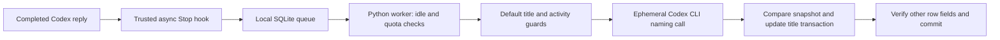

# Architecture

The hook stores UUID thread IDs, bounded turn IDs, generation IDs and debounce deadlines. It does not open paths from hook input or call a model. Exceptions are quiet; the host receives `{}` and exit code 0. Per-thread upsert and per-generation completion prevent duplicate events and preserve a new event arriving during a model call.

The Windows worker holds a single-instance byte lock. Empty-queue passes never discover threads or read transcripts. Ready events query only their thread ID. The worker excludes archived, pinned, subagent and active threads, and conservatively protects custom/unknown titles.

A daily counter reserves an attempt before invoking Codex. Failure counts; local-date rollover resets the daily count. Minimum spacing and global failure backoff apply independently. A failed event is completed rather than repeatedly retried by the timer. Later replies can enqueue a new event.

Naming uses the existing CLI login in an isolated scratch working directory. `--ephemeral`, `--sandbox read-only`, disabled hooks, lightweight context and argv-based invocation prevent persisted naming sessions and recursion. On Windows, native Codex is preferred over npm's Node wrapper and child processes use `CREATE_NO_WINDOW`. No global model settings are changed. CLI capability errors fail closed rather than dropping ephemeral flags.

Only the applicable display field is changed: paginated `name`, legacy `title`. `BEGIN IMMEDIATE` protects read/compare/write; a discovery snapshot detects title, activity, project and section changes while inference was running. Before commit the entire target row is compared with the original row plus the intended title. Other-field changes, including trigger effects, roll back the transaction. This is not a promise about unrelated application activity or future triggers that modify other rows/tables.

The private journal records prepared and applied entries. Restore accepts only applied entries and a matching current title. It never restores an entire database. Runtime counters, locks and journals belong to one installation; do not run multiple installations against the same Codex home.

The installer merges only its exact hook command, backs up existing hook configuration and optionally creates a hidden Windows startup shortcut. Trust remains a human action. `disable` persists the disabled switch before stopping the worker; `uninstall` removes its hook and owned shortcut, retaining runtime data.

The underlying reusable `src/rename` library includes other upstream adapters. The supported background path instantiates only `GuardedCodex`; it never discovers those other tools. Its generic CLI is not the installation interface for this project.
